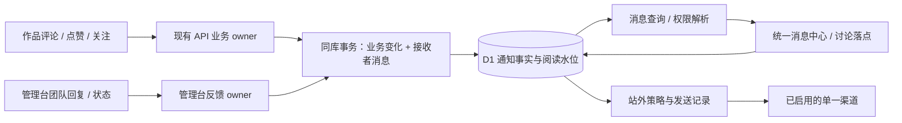

# GemiGo 互动、消息与适度提醒统一设计

日期：2026-10-13（Asia/Shanghai）

交付范围：研究与设计文档；没有授权据此启动功能实现、发送用户通知或新增运营任务。

状态：统一产品方案与站内首批设计已形成；站外渠道须满足本文接入条件后独立验收。本文的默认值是设计建议，不是已上线行为或用户确认的运营规则。

## 1. 用户要求与设计目标

用户要求：借鉴抖音等成熟产品，统一梳理评论、点赞等活跃度机制，形成体验好、能及时关注到重要变化、又不过分打扰的方案文档。

采用“统一消息中心 + 分级提醒 + 持续回访入口”。一个真实事件只产生一次接收者记录；是否显示红点、是否站外触达、是否合并，由统一规则决定。用户知道发生了什么、为什么通知自己、点击后能做什么，也能轻松减少提醒。

成功标准分成两层：工程上不漏关键事件、不重复打扰、不泄露内容、准确定位；产品上提高有效回应和真实回访，同时控制退订、屏蔽和投诉。通知点击率不能单独证明设计有效。

本方案服务已有创作者、作品使用者和反馈提交人。不预设最终产品定位，不照搬短视频平台的刺激机制，也不新增聊天、好友上线、签到奖励等没有当前任务依据的功能。

## 2. 现状与证据边界

本次核对当前主工作区代码；没有查询生产互动量，没有登录抖音客户端逐屏实测，也没有验证 GemiGo 生产版本与工作区完全一致。

| 已有能力 | 权威入口 | 本次确认的缺口 |
| --- | --- | --- |
| 作品评论、回复、软删除、分页 | [CommentService](../../workers/api/src/services/comment.service.ts)、[CommentRepository](../../workers/api/src/repositories/comment.repository.ts) | 写入后直接返回，未产生作者／被回复者通知 |
| 点赞、收藏、数量、个人关系 | [EngagementService](../../workers/api/src/services/engagement.service.ts)、[ReactionManager](../../frontend/src/managers/reaction.manager.ts) | 接收者消息未接通；部分失败仅写控制台；点击埋点不能证明成功 |
| 关注作者、关注数 | [FollowService](../../workers/api/src/services/follow.service.ts) | 关系没有被关注列表或订阅内容流消费 |
| 用户私有反馈与回复、状态 | [CommunityService](../../workers/api/src/services/community.service.ts) | 普通用户只能访问自己的反馈；回复和状态变化无主动提醒 |
| 独立管理台团队回复和处理状态 | [管理台反馈写入](../../workers/admin/src/feedback.ts) | 直接写同类业务表，绕过主站 CommunityService；只接主站会漏掉真实团队回复 |
| 作者累计点赞、收藏 | [CreatorHeader](../../frontend/src/features/profile/components/creator-header.tsx) | 缺少统一的近期互动和待回复入口 |
| 收藏关系与 Dashboard 筛选 | [Dashboard](../../frontend/src/features/dashboard/pages/dashboard.tsx)、[筛选逻辑](../../frontend/src/features/dashboard/utils/select-management-projects.ts) | Dashboard 输入先限定本人项目，不能作为收藏他人作品的找回入口 |
| 互动埋点与推荐流反馈 | [埋点合同](../../packages/product-analytics/src/contract.ts)、[推荐反馈](../../frontend/src/features/explore/recommendation/feed.manager.ts) | 已有互动信号，应复用；缺少成功、阅读、回应和回访的完整口径 |
| 部署结果持久化与后台恢复 | [DeployService](../../workers/api/src/services/deploy.service.ts) | 可接重要结果；不能用前端 SSE 收到消息作为唯一 producer |

主站没有完整通知 API、消息路由和未读状态。扩展中的铃铛是无点击处理的占位入口，SDK 的本机通知也不是跨账号互动系统。[历史评论方案](../logs/2026-01-10-product-comments/README.md)曾明确将通知排除在第一版之外。

补充边界：反馈库还有历史投票表，但当前主站服务、路由和界面没有有效投票操作；不把残留表当作产品能力。现有作品评论服务仅检查作品存在，不能据此推断私有作品权限已经完善；新消息链路必须补齐访问判定。

## 3. 成熟产品参考：已核实机制与本项目取舍

| 参考与官方来源 | 已核实的公开机制 | GemiGo 的取舍 |
| --- | --- | --- |
| [抖音 PC 官方常见问题](https://www.douyin.com/help)，「弹窗骚扰」部分 | 点赞、评论、提及、新增关注、新作品等通知可分别关闭 | 提供按类型控制；这是 PC 文档证据，不能外推手机端全部细节 |
| [TikTok Notifications](https://support.tiktok.com/en/using-tiktok/messaging-and-notifications/notifications) | Inbox 活动筛选、按类型开关、推送静默时段 | 将消息留存与站外打扰分开；提供分类和静默。证据来自官方搜索索引，直接页面抓取受 robots 限制 |
| [Apple Notifications 设计指南](https://developer.apple.com/design/human-interface-guidelines/notifications) | 信息简洁、避免同一事项反复通知、前台轻量更新、避免敏感预览 | 当前会话可见时不用额外弹窗；点击直达上下文；默认站外不展示私密正文 |
| [GitHub 消息管理](https://docs.github.com/en/subscriptions-and-notifications/how-tos/viewing-and-triaging-notifications/managing-notifications-from-your-inbox) | 已读、未读、保存、完成、退订是不同动作 | 已读不等于已回复；保留稍后回应能力，并允许针对作品停止提醒 |

公开资料没有提供抖音的精确聚合窗口、发送预算或个性化算法。下面的数值是 GemiGo 可验证的初始假设，不能宣传为复刻抖音内部规则。本文不声称借鉴这些机制就能达到相同留存或商业效果。

比较三个可行方向：

| 方向 | 优点 | 代价与判断 |
| --- | --- | --- |
| 每事件独立通知并默认站外发送 | 路径短，早期容易看见事件 | 人气增长后大量重复打扰；取消点赞也容易误触发。不采用 |
| **统一消息中心，直接互动优先、轻互动聚合** | 重要事项可行动，低价值打扰受控，适合现有规模 | 需要可靠未读和聚合状态；推荐 |
| 从首版引入 AI 排序、预测发送时机和多渠道平台 | 能探索个性化 | 缺乏生产基线，难解释和验证，增加系统复杂度。延后 |

## 4. 三条完整用户链路

### 4.1 作者收到评论并回应

小林在首页试用作品，登录后评论。评论保存成功才显示成功；作者没有操作也会获得站内消息。作者打开主站，铃铛显示重要未读数，点开后看到“@小林 评论了《色彩实验室》”及内容摘要。

作者点击消息，系统打开对应作品的主站讨论上下文并定位评论，评论即使不在第一页也能找到。作者回复，小林收到“作者回复了你”；作者原消息已读，原评论从待回复列表移除。退出后再打开，阅读和回应状态保持。只有外部渠道已启用且事件仍未读时才考虑站外提醒。

判定：两个账号都知道实际变化，完成一次往返；不需要刷完整作品列表，不靠手动刷新某个评论抽屉碰运气。

### 4.2 大量点赞仍保持安静

一个作品半小时获得 20 个新点赞。作者站内看到一条“20 人赞了《色彩实验室》”，可展开查看；重要未读数字不被 20 个赞淹没。作者正在作品页面看这些变化时，只更新数量或显示“有新互动”，不抢焦点、不发系统通知。

作者读取后又有新点赞，只把新增部分显示为未读；不会把旧的 20 个赞重新算一次。撤赞会从有效成员中移除；反复点赞不能反复触发站外提醒。作者可以关闭该作品的轻互动红点，仍能主动查看累计数据。

判定：反馈真实可见，打扰与有效新增信息匹配；热门作品不会压住评论和团队回复。

### 4.3 用户离线时反馈被处理

用户在 `/community` 提交私有反馈，团队在独立管理台回复并将状态改为“已完成”。两个真实写入口都产生用户站内消息，按同一反馈合并为一个处理会话，保留回复与状态时间线。

用户再次登录看到“GemiGo 团队回复了你的反馈”，点击只打开自己的反馈。未登录时先登录再恢复目标；登录成其他账号时不显示标题或正文。若用户主动开启设备推送，在静默时段结束后收到简短提醒；反馈正文不出现在系统预览里。

判定：私有反馈有回应闭环，主站和管理台写入语义一致，静默期间不发送，返回目标仍遵守当前权限。

## 5. 统一信息架构与入口

### 5.1 消息中心

新增 `/notifications`，桌面 Header 铃铛打开轻量列表，提供“查看全部”；窄屏直接进入消息页，不依赖悬浮控件。已有登录用户均可用，匿名用户不显示虚构未读。

消息页筛选为「全部」「评论与回复」「赞与收藏」「关注」「反馈与系统」，默认先展示「需要关注」分区，其内按最新事件倒序；再展示轻互动。用户可切纯时间顺序，分区标题解释排序，不能无说明地把新评论藏在旧点赞下面。

每项包含身份、动作、作品／反馈、摘要、时间、未读标记与明确主动作。作品缩略图有文本替代；身份缺失用既有匿名作者展示，不编造用户名。中英文沿现有 i18n，时间按用户本地显示。

原型结构（布局建议，非已实现画面）：

```text
消息                         通知设置
全部  评论与回复  赞与收藏  关注  反馈与系统

需要关注 · 2                 全部标为已读
● @小林 评论了《色彩实验室》          5 分钟前
  “能不能保存自己配的颜色？”           查看并回复
● GemiGo 团队回复了你的反馈          30 分钟前
  处理状态：已完成                     查看反馈

其他动态
  @阿青 等 19 人赞了《色彩实验室》       今天
  有 3 位用户关注了你                   今天
```

### 5.2 待回复、收藏与关注

消息中心「评论与回复」增加「作品收到的评论／对我的回复」与「待回复」筛选。待回复只表示“别人给本人作品的顶层评论尚无本人的直接回复”，不推断每条回复都欠一次回应；可标记“无需回复”，用对应评论的 disposition 保存。评论内容变化或新增回复不自动撤销该选择；新的顶层评论另行判断。

“我的收藏”“我的关注”放在个人主页的明确入口：收藏展示所有仍可访问的收藏作品，不经过本人拥有项目的过滤；关注列表可取消关注，并进入作者主页。新增关注消息点击进入“关注我的人”名单，不能误导到“我关注的人”；名单消费既有关注关系，公开身份可打开主页。关注动态展示关注作者的新作品，普通重新部署不制造一条新作品通知。

这些回访入口与通知共享既有关系数据，不各建一份收藏／关注状态。Dashboard 继续承担项目管理，避免把管理列表同时充当消费端收藏夹。

## 6. 事件、接收者、优先级与默认行为

优先级描述用户任务价值，不代表可以突破静默和用户选择。

| 事件 | 接收者与合并规则 | 站内等级 | 默认站外策略 |
| --- | --- | --- | --- |
| 作品顶层评论 | 当前作品作者；排除自己 | 重要；每评论一项 | 开启“直接互动”后，未读等待 10 分钟再评估 |
| 回复作品评论 | 被回复者；作者不是发送者／被回复者时也收到一项；同一接收者只保留较具体的“回复”语义 | 被回复者为重要；作者旁观为普通 | 被回复者可发送；作者旁观仅摘要 |
| 作品点赞 | 作品作者；作品 + 类型 + 接收者 + UTC 日聚合 | 轻互动 | 即时关闭；仅主动开启的每日摘要 |
| 作品收藏 | 作品作者只看到匿名新增人数，不暴露收藏者身份 | 轻互动；同上聚合 | 即时关闭；仅摘要 |
| 新增关注 | 被关注者；按接收者 + UTC 日聚合 | 轻互动 | 即时关闭；仅摘要 |
| 关注作者首次公开成功发布作品 | 当前仍关注该作者的人；不把普通部署更新当首次发布 | 发现动态；默认不占重要红点 | 默认关闭；用户对作者另开提醒后进入摘要 |
| 团队回复用户反馈 | 反馈提交人；按反馈会话合并 | 重要 | 开启“反馈处理”后，等待 10 分钟评估 |
| 反馈状态实际改变 | 反馈提交人；同反馈会话，保留变更历史 | 重要 | 与同一会话回复合并，不重复发两封 |
| 自己发起的部署终态 | 部署发起者；以 attempt ID + 终态去重 | 失败重要、成功普通 | 成功默认关闭；失败可选提醒；正在看结果时静默更新 |

收藏人数按有效 distinct 用户数，不暴露头像、用户名、用户 ID；点赞和关注可以展示公开身份。该选择是隐私与激励之间的设计取舍，需作为行为变更向已有用户解释。

没有 owner 的作品不猜测接收者。作品作者／被回复者／反馈提交人均由服务端业务事实推导，客户端不能提交收件人。团队展示身份 `gemigo-admin-team` 是保留身份，不是可接收消息的用户账号；新反馈给运营人员的提醒属于独立管理台任务，不扇出给主站所有管理员。

提及、评论点赞、私信和合作邀请目前没有有效业务链，暂不产生这些事件，也不展示不能使用的设置开关。

## 7. 聚合、未读和阅读：一致而可解释

### 7.1 聚合

评论首项立即进入站内；同一回复目标的连续回复可按会话聚合，点开看到各条记录。普通新评论不因聚合失去独立待回复入口。轻互动按上一节键聚合，站内实时更新有效人数；日界使用 UTC 固定键避免改时区后分裂，界面用本地时间，不宣称等于用户的“本地今天”。

确定性组键：顶层评论为 `comment:<commentId>`，回复为 `replies:<targetCommentId>`，反馈为 `feedback:<feedbackId>`，部署为 `deployment:<attemptId>`，轻互动为 `<kind>:<subjectId>:<UTC-date>`；均与 recipient ID 联合唯一。回复详情逐条展示，不把不同目标或不同用户的私有反馈合在一起。混合普通与重要成员的组，仅有存活、未读且有提醒资格的重要成员时进入重要分区。

反馈回复与状态共用 `feedback:<id>` 会话，不隐藏具体状态。部署按 attempt 独立，同一 attempt 的重复恢复结果不重建消息。聚合详情使用稳定游标分页，不在第一屏加载全部成员。

### 7.2 红点

Header 数字只统计重要未读的聚合项，上限显示 `99+`；只有轻互动时显示小圆点，提示语说明“有新的赞、收藏或关注”。消息页各分类显示自身未读项数。展示的是消息项，不是点赞人数，不能出现“一个聚合项对应 20 个未读数字”。

关闭某类红点后，该类继续作为历史可查看，不参与铃铛或分类未读。关闭站外推送不会让站内消息丢失。筛选、打开消息页、滚动经过卡片都不自动全部已读。

### 7.3 阅读与并发

服务端每条接收者记录有单调递增 `seq`。消息返回 `observedThroughSeq`；点击成功打开上下文后，只确认该项已展示到的序号。聚合中刚到的新事件仍保持未读。全部标已读也提交当前列表响应的 `snapshotSeq`，不能用点击处理时的服务器当前最大值吞掉并发新消息。

阅读水位只前进，不回退；刷新、重登和多设备都取服务端状态。本地只做乐观显示，失败撤销并提示重试；不靠 localStorage 作为权威。浏览目标已加载且确实展示对应评论／反馈时间线时，可以同步确认覆盖到的事件，不能仅凭“在线”或“页面打开”判定已读。

全部已读使用同一阅读表的保留键 `__all__` 保存用户级水位，实际 group key 禁止使用此键。每项的有效已读上界为用户水位与该组水位的最大值；一次全部已读只更新一行，不逐项扫描写入所有组。轻互动的不可打扰事件可以进入历史与人数展示，但只有 `attention_eligible=true` 的存活事件参与未读与发送候选。

“已读”“无需回复”“关闭该作品提醒”是不同动作。读过仍可待回复；无需回复不删除评论；停止提醒不取消收藏或关注。

## 8. 适度打扰的统一策略

以下是首轮待验证默认值，统一由服务端策略 owner 管理，不能散落在各 UI 和渠道。

| 控制维度 | 推荐初始规则 | 用户可见结果 |
| --- | --- | --- |
| 前台 | 不弹系统通知、不播放声音；评论面板正在阅读时显示“有 N 条新评论”并由用户展开 | 保持阅读位置和输入草稿 |
| 站内更新 | 页面可见时最多每 60 秒刷新摘要；聚焦窗口立即刷新，10 秒内去抖；消息页可手动刷新 | 重要消息通常在 60 秒内可见，不宣称秒级实时 |
| 站外首次许可 | 默认关闭；用户体验到一次有效互动后，在设置里自主启用 | 不在注册或首次访问时强制权限弹窗 |
| 直接互动等待 | 事件后 10 分钟；已读、撤回、不可访问则不发送 | 给站内自然回应机会 |
| 全渠道预算 | 每用户滚动 24 小时最多 3 次站外触达，其中最多 1 次每日摘要；两次触达至少间隔 60 分钟 | 不因多个设备将预算翻倍 |
| 聚合发送 | 同作品／反馈在等待窗口合成一次；按重要程度选项，推送合并同一批未读会话，剩余只给入口 | 多个评论不变成多次系统弹出 |
| 预算用尽 | 保留站内；未读直接互动可以进入下次符合预算的摘要，不排队逐条补轰炸 | 安静不等于遗失事件 |
| 静默 | 产品建议默认用户当地 22:00–08:00；支持 IANA 时区、跨午夜、自定义，未知时区不站外发送并提示设置 | 静默结束重算相关性，最多合成一次 |
| 摘要 | 主动开启；用户当地 18:00，若在静默期延到下一允许时刻；无有效新增未读不发 | 每日摘要不是固定催回访 |
| 过期 | 直接互动站外候选 48 小时后放弃；轻互动／发现摘要只覆盖最近 24 小时 | 不在一周后补发旧赞 |
| 忽略 | 连续 7 天无站内阅读且至少 3 次站外发送，暂停本类别即时提醒；有摘要许可才降为摘要 | 下次登录说明，可恢复；不把系统通知点击当阅读 |

每日摘要限制按用户本地日，滚动预算按绝对时间；改时区不能清空已消耗预算。这里的产品静默与仓库的 AI 夜间平台行动约定分别管理：前者服务最终用户，后者约束代理操作，不能互相替代。

策略判定顺序固定：真实成功 → 合法接收者与当前权限 → 排除自己／撤销／屏蔽 → 记录站内 → 站外许可与类别选择 → 已读与过期 → 静默 → 同会话聚合 → 全渠道预算和冷却 → 发送前再次校验。关闭许可或取消关注后，未发送候选立即失效；已经显示的系统通知无法保证召回，不能宣称可撤回。

站外仅使用用户主动开启的设备 Push；同一批提醒只选最近订阅的一台设备，避免多端重复。响应超时、是否接受不明时记 unknown，不改用另一设备重发；已接受 Push 不因“没打开”补发。安全、账务等未来强事务消息需要独立合同，不能借“系统通知”绕过当前限制。

## 9. 设置、内容与异常体验

设置位于消息中心和个人设置，分「站内红点」「站外提醒」两层；站外有评论与回复、反馈处理、部署失败、每日摘要、关注作者提醒等真实可用项。设备状态显示关闭、已启用、设备拒绝、渠道不可用；未接入渠道显示说明而非能保存成功的假开关。

站内默认重要数字与轻互动圆点开启，发现动态不开红点；站外所有类别和摘要默认关闭。24 小时／7 天“暂停提醒”仅暂停站外触达，站内继续收取和显示；选择时文案明确说明。类别红点和作品静音按各自设置生效，不能用同一个含糊的总开关同时改变三种行为。

支持全部暂停 24 小时／7 天、某作品停止提醒、仅关闭该类红点、取消关注、取消设备订阅。作品静音默认同时抑制该作品的所有站外互动和站内红点，但消息仍保留；到设置解除后不追发静音期间旧事件。

反馈私有内容站内按权限展示，站外标题只写“你的反馈有新回复”。作品评论站外默认也只写作者动作和作品名称，用户主动允许预览后才展示简短正文；HTML／Markdown 转义，不放可执行内容。不能用“有人在等你”“错过就没了”等无法证实的话术。

| 状态 | 设计响应 |
| --- | --- |
| 没有消息 | “新的评论、回复和反馈处理结果会出现在这里”，给探索／收藏入口；无假红点 |
| 加载／离线／失败 | 保持已加载列表，显示过期状态和重试；不可把错误渲染成零未读 |
| 匿名访问通知深链 | 保存站内目标，登录后重新校验；不把反馈正文放进 URL |
| 被删除、转私有、失去权限 | 不暴露旧摘要；显示“内容已不可用”，可关闭对应消息 |
| 账号切换／退出 | 清理消息缓存、分页、请求代次和会话上下文；迟到响应不得写入新账号 |
| 键盘与辅助技术 | 铃铛读出重要未读数；抽屉有焦点管理和 Escape 返回；不连续播报点赞更新；小屏触控目标至少 44px |
| 消息回来后目标不在首屏 | 服务端按 comment ID 返回有权限的上下文；定位并短暂高亮，不逐页猜找 |

移动端通知点击必须留在 GemiGo 的讨论页，不能复用当前“小屏预览直接打开外站”并丢掉评论。新增统一 `/apps/:projectId/discussion?commentId=...` 作为通知落点；桌面也可在此挂载既有预览和评论 panel。反馈落点为 `/community?feedbackId=...`，扩展现有选中能力。目标参数均按 ID，服务端决定是否可访问。

## 10. 架构：一个状态 owner，可靠业务边界

沿用 React、现有 presenter／manager／store、Workers 与 D1。站内首批不新增消息中间件、AI 调度或独立推送服务。主站 API 与独立管理 Worker 是两个真实 producer，因此抽出最窄的共享通知合同和 D1 statement 构造模块，拟放 `packages/notifications`；不让管理 Worker 导入主站 service，也不复制规则。



### 10.1 最小持久模型

下列为拟新增表／字段合同，具体 migration 必须沿项目检查入口验证，不是当前数据库结构。

| 实体 | 权威职责与关键字段 |
| --- | --- |
| `notifications` | 每接收者每真实事件一行：`seq`（INTEGER 主键）、`event_key`、`recipient_id`、`actor_id`（收藏对外不可返回）、`kind`、`subject_type/id`、`comment_id`、`group_key`、`priority`、`attention_eligible`、`created_at`、`revoked_at`；唯一 `(recipient_id,event_key)` |
| `notification_group_reads` | `(recipient_id,group_key)` 唯一，`read_through_seq` 单调前进；不保存第二份人数和未读计数 |
| `notification_preferences` | 用户类别／渠道开关、时区、静默、暂停期限及同意时间、版本；敏感渠道许可不能由请求缺字段自动开启 |
| `notification_subject_mutes` | 用户 + 作品／会话的静音；不改变业务关注和收藏关系 |
| `comment_response_dispositions` | 作者对本人作品顶层评论标记“无需回复”；待回复还必须检查真实回复、评论存活和作品归属 |
| `notification_deliveries`（站外阶段） | 收件人、渠道、固定事件成员与上界、幂等键、冻结渲染 payload、状态、`not_before`、TTL、租约、次数、供应商 ID／结果；同 delivery 重试保持同 payload |

消息事实只存稳定引用和必要的类型元信息，标题／正文由当前有权限的业务源解析。收藏身份不得进入公开 DTO、分析明细、推送 payload 或头像拼接。读列表、未读数、摘要统一复用权限与静音 predicate，避免已不可访问的私密消息仍贡献红点。

按 `(recipient_id,created_at,seq)`、`(recipient_id,group_key,seq)` 与发送状态／时间建索引。先按接收者限定后做聚合，游标含分区、最新序号与稳定 group key；新到消息插入顶部提示，后续页不重复。相同序号水位覆盖删除／撤回后仍存活成员，不能将人数当阅读版本。

站内消息保留 90 天，按相同截止时间过滤查询并批量清理；到期未读同时退出数字，界面说明历史窗口。业务评论与关系不因此删除。无保留消息的组阅读记录可清理，用户级阅读水位持续保留；静音记录随业务对象存在而保留，不因消息过期重置用户选择。发送／退订／幂等审计最少 90 天。删除账号清理个人消息、渠道地址和会话缓存；不把消息表当长期业务审计库。

### 10.2 成功事件、事务与幂等

本方案选择“业务变化和接收者消息在同一 D1 batch 事务提交”。不能先成功评论再 best-effort 写通知，也不能用 `waitUntil` 或浏览器埋点保证关键消息。Cloudflare 官方说明 [D1 batch](https://developers.cloudflare.com/d1/worker-api/d1-database/#batch) 内语句按顺序执行，失败会中止或回滚整个序列；需要用条件 SQL 和唯一约束实现，并实际验证，不能在事务外先读后写假装具备并发保护。

业务 owner 决定真实动作与接收者，共享模块生成可组合的通知 statements；业务 repository 接收这些 statements 并负责一次事务。通知服务只负责策略、查询、读取和送达，不重新实现评论权限和作品状态。直接互动接收者最多两人；关注新作品使用下一节的按需读取，避免在发布请求扇出全部粉丝。

幂等规则：

- 新评论使用稳定 submission ID，前端首次提交生成，失去响应后重试沿用；后端按作者 + submission ID 判重并核对内容，不把双击产生第二条评论。管理台已有稳定 `replyId`，直接复用。
- 点赞／收藏／关注关系新增 `activation_id`，只有真实不存在→存在才产生事件；同一次幂等 POST 返回既有关系。通知 INSERT 从同事务实际插入的 activation 读取；取消动作按旧 activation 撤销其有效消息并取消候选发送，重加获得新 activation。
- 同用户对同作品同类型轻互动在滚动 24 小时最多产生一次有效提醒资格，所有真实新增仍记录，但被抑制的再次激活置 `attention_eligible=false`。人数按未撤销的有效当前激活 distinct actor 计算；未读只看有资格事件的 seq，重加可以恢复人数但不恢复红点。抑制历史查询包含已撤销记录，不因删除当前关系重置。业务累计数仍从既有关系表计算，不能拿保留窗口的通知人数替代。收藏、点赞不作为积分奖励触发器。
- 反馈状态通知按实际版本去重；相同状态不产生事件。主站和管理台共享 version／mutation token 条件写入；管理台现有 expected-status 冲突返回仍保留，不用更新时间作为唯一事件 ID。
- 部署按 attempt 终态去重，持久业务终态和消息一同提交；前台 SSE、后台恢复和重放走同一 owner。首次公开成功发布另写一次稳定的 `first_publication` 事实；草稿、失败、私有发布和普通重部署不触发新作品动态。

首次公开发布覆盖两种实际边界：公开作品首次成功部署，以及已经成功部署的私有作品首次转为公开。后者由现有 ProjectService 的可见性写入 owner 产生，必须已有确认可访问的成功版本；不能只监听部署结果。publication 唯一 project ID，转私有后再公开仍是同一作品，不再制造“首次”。

若业务＋消息事务失败，整个操作失败并保留用户草稿、稳定提交 ID；可以重试，不向用户显示“发送成功”。站外失败与业务事务分离，不能阻断评论或部署结果。

### 10.3 关注动态与渠道送达

关注动态采用读时 join 当前 `user_follows` 与首次公开发布事实，按 `(published_at,project_id)` 分页，过滤当前不可访问内容和已取消关注。只有 `follow.created_at <= first_publication.at` 的作品计作订阅新增；已有作品可在作者主页查看，不突然补一批“新作品”。消息页「关注」分区内展示动态卡片；独立动态阅读水位不计重要红点。用户对作者额外订阅站外摘要时，同一已记录出版事实被发送任务消费，唯一键 `(recipient_id,publication_id)`。

即时站外候选从未读消息查询生成；发送表就是持久重试记录，不再建平行外发队列。现有 API Worker 的两分钟 cron 可有界执行扫描与发送，通知任务隔离异常，设置独立预算，不能阻塞部署恢复。站内读取无需等 cron。

发送前通过条件更新认领租约，同时原子预留用户预算；多 Worker、两个渠道、多个设备不能各自领取一份预算。取消且确定未调用供应商时释放预留；请求已接受或结果未知则消耗预算。租约过期由下轮接管，同一 delivery 幂等键和固定 payload 不变。用户后来阅读／退订可以取消尚未发出的候选；外部请求开始后存在竞态，记录边界，不能声称跨供应商与 D1 达到 exactly-once。

状态区分 `pending / leased / accepted / delivered / retryable / unknown / cancelled / failed`。`accepted` 只说明供应商受理；没有送达回执不能记 delivered，送达也不是阅读。已发送内容不能因为重试重新渲染成另一份 payload；来源删除／权限撤销且尚未发出时取消，不把旧正文发出去。


Web Push 是下一渠道：HTTPS、主动用户操作请求权限、Service Worker、VAPID 订阅、端点失效清理均须完成真实浏览器验证。[MDN](https://developer.mozilla.org/en-US/docs/Web/API/Notifications_API/Using_the_Notifications_API)明确权限与安全上下文要求。设备权限不等于用户同意所有类别；主站、桌面与扩展共享服务端已读和预算，宿主只负责展示。首批不要同时开发三套系统通知实现。

### 10.4 API 和 owner 边界

拟新增（均须 session 鉴权，recipient 从 session 得到，GET 无写副作用）：

| 入口 | 行为 |
| --- | --- |
| `GET /api/v1/notifications?category=&cursor=` | 聚合列表、重要／普通未读与 snapshotSeq，不返回未经权限过滤的摘要 |
| `GET /api/v1/notifications/summary` | 有界未读汇总，不加载全列表；复用相同权限、静音与保留期限 |
| `POST /api/v1/notifications/read` | group + observedThroughSeq，或明确 snapshotSeq 的全部已读；防跨用户、未来序号 |
| `GET/PATCH /api/v1/notification-preferences` | 读／改本人设置；校验时区和开关、返回实际生效状态，站外启用要求渠道可用 |
| `POST/DELETE /api/v1/notification-mutes` | 本人的作品／会话静音；相关身份校验 |
| `GET /api/v1/projects/:id/comments/context?commentId=` | 按当前权限返回目标和必要回复上下文，避免第一页定位失败 |
| `POST /api/v1/comments/:id/response-disposition` | 本人作品作者标记无需回复／恢复待回复，检查当前归属 |
| `GET /api/v1/me/favorites`、`GET /api/v1/me/following` | 消费既有关系，分页和当前权限过滤 |
| `GET /api/v1/me/following/publications` | 关注动态和 publication 游标，不修改阅读水位；阅读用独立显式 mutation |

前端新增一个 NotificationManager + 一个通知 store，绑定当前 user ID、请求代次和可见页刷新；Header、消息页与目标 panel 共用。登录／退出生命周期启动／停止轮询。重要未读不是全局 UIManager 临时 toast 的派生状态。

本次配置核对：API Worker 的 PROJECTS_DB 与 [管理 Worker 的 ANALYTICS_DB](../../workers/admin/wrangler.jsonc) 指向相同 database ID，现有同库约束成立；发布时仍需对账实际环境，不能只看环境变量名字。若未来拆库，须重新设计可靠 producer 边界，当前合同不承诺跨库事务。

## 11. 可靠性、权限与反滥用

用户能访问通知不代表能访问源内容；列表、摘要、深链、成员详情与站外发送均重新检查 current authorization。私有作品仅 owner／明确有权者可评论、读取和收提醒；现有 public 评论读取不能直接沿用为新链路授权证明。收藏、关注找回也过滤非公开与删除内容。作品归属发生变化时不给新作者补旧收件箱，旧接收者无权内容从可见消息和数字退出。

业务层继续执行内容长度、频控和身份校验。首批给接收者提供“该作品停止提醒”，消息详情可定位业务源，不在通知内新增一套举报存储。发现定向骚扰后，用户级屏蔽需要业务权限 owner 支持才能上线，不能先做一个仅隐藏消息却允许继续触达的假屏蔽。

源删除、撤赞、取消关注、账号删除同事务撤销相关仍有效消息／候选；查询权限过滤承担迟到恢复的最后防线。内容被下架后不保留旧正文快照用于吸引点击。少量管理员审计可存事件类型和源 ID，日志不得批量吐邮箱、评论正文和 push endpoint。

高流量时限流摘要读取、后台有界扫描、记录 query rows 和扫描水位。若现有 cron 加发送导致部署恢复受影响，移出发送消费者；保留同一持久事实与策略，不复制通知系统。没有实测吞吐前不提前引入 Kafka 或独立通知集群。

## 12. 可执行验收合同

文档交付验收：来源可追溯、当前能力与拟议能力区分、三条黄金链路完整、规则有明确 owner、关键异常有判定、本文件可直接交给后续实现任务。当前文档没有运行验收通过的含义。

| ID | 场景与证据 | 实现完成后的通过条件 |
| --- | --- | --- |
| A1 | 两账号从真实首页发表评论、作者从铃铛进入并回复 | 评论成功与收件箱一致；作者／被回复者正确；深链定位；完成往返 |
| A2 | 作者也是被回复者／发送者自己／无 owner | 每合法接收者至多一条；自己不收；不猜测身份 |
| A3 | 管理台真实回复＋变更状态，主站用户返回 | 两条时间线事件合并为一个反馈项；私有权限正确；重复 replyId 不重发 |
| A4 | 20 个账号点赞、取消与重复添加 | 有效人数正确；一个聚合项；数字不等于 20；24 小时抑制有效 |
| A5 | 用户读到 seq=N，同时有 N+1 到达；两设备交错读取 | 只确认 N；N+1 未读；水位不回退，全部已读同样成立 |
| A6 | 收藏他人作品并从“我的收藏”回来 | 真实找回，不受本人项目列表范围限制；撤收藏正确 |
| A7 | 关注后新作品首次成功发布、失败、私有、重部署、取消关注 | 只有合格首次公开成功发布计新增；取消后无新提醒；历史不冒充新增 |
| A8 | 目标在后续页、移动端、未登录后登录、账号切换 | 正确上下文和定位；不跳外站丢评论；不泄露另一用户缓存 |
| A9 | 评论／通知事务中途失败，浏览器失去成功响应后重试 | 无业务成功但消息缺失；无重复评论；保留草稿与稳定 submission ID |
| A10 | 源删除、转私有、撤赞、所有权变化、90 天过期 | 列表、摘要、红点、站外候选同语义失效，不残留敏感摘要 |
| A11 | 前台输入评论、隐藏页、短视口、键盘和屏幕阅读器 | 不抢焦点、不跳位置；轮询停启正确；44px 操作可达；错误不是零消息 |
| B1 | 明确许可、实际设备权限与推送展示 | 许可前零站外发送；渠道不可用有解释；受理、送达与阅读区分 |
| B2 | 静默跨午夜、未知时区、夏令时、改时区、摘要重叠 | 静默期零发送；未知时区不发；预算不重置；只一次合格合并触达 |
| B3 | 多 cron 并发、供应商超时、24h 幂等边界、跨渠道 | 原子预算／租约；不盲目换渠道；幂等窗口外停止重试 |
| B4 | 候选等待时已读／退订／源撤回；设备端点失效 | 未发送立即取消；无权内容不发；不反复重新请求用户权限 |
| B5 | 连续忽略、预算耗尽、7 天静默后恢复 | 不积压逐条轰炸；摘要需许可；降频可解释、可恢复 |

工程证据使用定向 Worker/D1 集成测试、时钟与供应商故障注入、前端状态测试以及真实浏览器双账号链路。Push 用受控测试账号和实际支持的浏览器；模拟受理不能作为真实送达。新增 TypeScript 和闭集 kind 时必须完成 API／admin／frontend／共享 package 的类型检查及传播对账。

性能门槛是拟议工程目标：每用户 1 万条保留消息、100 个聚合项首屏、总库 100 万条消息的 fixture；summary／首屏服务端 p95 ≤500ms，单可见页面摘要轮询每分钟至多一次，隐藏页零定时轮询。测量声明环境、数据库位置、冷／热请求与权限查询成本；上线前测不达标就调整查询，不能用单用户最佳响应证明达标。不是当前实测指标或生产 SLO。

## 13. 衡量真实价值与保护用户

复用现有产品分析合同，但服务端成功事实与分析采集分开：用户关闭分析收集不影响消息业务。统计不得写入评论正文、邮箱和收藏者身份；是否可关联用户必须遵循既有隐私合同，不偷扩展匿名埋点。

| 指标 | 明确口径 |
| --- | --- |
| 关键消息生成完整率 | 当期合格业务事件中，预期接收者记录全部成功提交的比例；按 producer 分组，管理台不能被漏掉 |
| 重复打扰率 | 同一 recipient + delivery 幂等事实重复外发的比例；与合法聚合、同组后续新事件区别 |
| 有效回应率 | 收到合格评论／回复的用户中，在 48 小时内通过真实业务写入回应的人数；不以打开通知替代 |
| 首次回应耗时 | 从合格评论业务提交到首个作者回复；报告未回复占比和分位数，不只算成功样本均值 |
| 互动后回访 | 收到互动后 1／7 天内回到主站的用户比例；事件接收与站外渠道分别分层，跨期 cohort 等待完整窗口 |
| 创作者持续投入 | 收到互动后的 7 天再次成功发布／更新比例；不宣称通知造成了更新 |
| 打扰成本 | 每活跃用户站外次数、关闭类别、退订、退信、投诉、不可访问点击率、静默违规次数 |

没有生产基线前不设凭空的提升百分比。先完整观测至少 7 天获得描述性基线；做实验时以用户为单位随机分组，保持站内能力一致，对已明确许可者比较温和站外策略与仅站内，对照污染与样本量需检查。统计证据不足就报告观察，不下显著提升结论；7 天回访需完整暴露后再等待 7 天。

取消订阅和投诉升高时先降频／停外发，站内继续可用。确定出现越权正文泄露、静默违规、重复发送则立即关闭对应渠道并保留审计。不能为了提高点击恢复已关闭类别，不能用推荐曝光或消息数量替代真实留存。

## 14. 落地顺序、上线门与保留项

这是一份统一方案，不是本次已经启动的开发计划。后续实现建议按依赖分批，每批都交付完整可用链路，不先上空铃铛或不能定位的通知。

| 批次 | 完整成果 | 依赖与发布验收 |
| --- | --- | --- |
| I：站内闭环 | 评论／回复、轻互动、团队反馈的统一记录、聚合、读取、设置、消息中心、移动讨论落点、待回复、收藏／关注找回 | A1–A6、A8–A11；先 schema，再双 Worker producer 和 API，最后前端；同库与管理台实际链路必须核实 |
| II：持续关系 | 首次公开成功发布事实、关注动态、部署终态消息 | A7 和部署前台／恢复一致性；必须从真实成功状态 owner 产生，不从客户端点击制造事实 |
| III：温和站外 | 设备主动许可、直接互动等待、摘要、静默、预算、退订与可靠外发 | B1–B5；专用 VAPID 与设备订阅真实验证后才启用；默认外发开关保持关闭 |
| IV：设备渠道 | 一个实际需求明确的宿主 Push，沿用同一策略、预算和已读 | 完成真实设备和多端验收后再扩其他宿主；不一次开发主站／桌面／扩展三份 |

在第一批切换时只为切换点后的新事件生成未读；既有累计点赞／收藏和评论继续可查询，不给所有用户回灌历史红点，也不发送历史摘要。迁移先新增表和源 idempotency 字段，保留现有业务接口兼容旧客户端；新客户端稳定 ID 是增强合同，旧客户端重复 POST 的既有风险要明确，不把没有 ID 的旧请求宣称可自动判重。

新增消息 producer 要有服务端总开关、按事件和站外渠道独立开关。关闭外发不关闭站内；回滚 UI 后业务表及已提交消息保留，不能通过删除表回滚。老 Worker 与新 schema 共存需验证；重新开启只处理仍有效新事件，不补发暂停期间积压。

需在实现阶段落实的外部条件：API/admin 实际绑定同库、站内双账号测试环境、项目专用 VAPID、受控测试账号、目标设备支持。没有这些条件仍可以完成文档及站内开发，不把未满足条件的站外功能标为可上线。

保留：统一可靠记录、类别控制、聚合、阅读水位、当前权限、回应入口、收藏／关注关系复用。删除／替换：扩展空铃铛占位的虚假可用性、各入口自行维护未读和发送策略、只靠前端埋点生成接收者消息。延后：AI 发送时机、运营营销混流、私信、评论点赞、提及、通用工作流 DSL 和大规模消息基础设施。

## 15. 方案审查结论

审查范围是本文件的目标覆盖、来源准确性、用户链路、owner、权限、并发、重试、打扰控制与验收可执行性；没有产品代码实现或上线效果验收。

审查时重点反例：只接 CommunityService 会漏管理台回复；小屏直接打开外站会丢评论上下文；“全部已读”用最新服务器值会吞并发新事件；撤赞后重加会绕过提醒抑制；外发超时立刻换渠道会重复；多设备同时推送会重复打扰。相应机制已写入本文，不留给实现者自行猜测。

初稿审查发现并已关闭：全量已读缺少有界持久水位、撤销再激活的展示人数与提醒资格混用、消息过期可能清掉作品静音选择，以及私有成功作品转公开缺少 publication producer。修订分别使用用户级水位、attention_eligible、按业务对象保留静音、双边界首次公开事实；验收覆盖并发、重加、保留期和可见性切换。

抽象审计：业务 owner 继续拥有评论／关注／部署事实；通知 owner 只拥有接收者消息、读取、策略与送达。共享持久模块服务 API 与 admin 两个真实 producer，有必要性；聚合为查询结果，不另存可漂移计数；关注新作品读时 join 避免无界扇出；站外发送表只在真实渠道进入时增加。不新增通用事件总线和 AI 调度框架。

结论：统一设计与站内首批可以作为后续实现输入，`design-document=required`，站内首批 `design-review=passed`（当前文档范围）。站外产品规则和候选技术已设计，实际设备许可、VAPID 与浏览器能力须在对应批次核验；这些外部条件不等于已有可用渠道。实现计划需在启动对应批次时依据当时代码与资源形成，本次不创建空计划或自动任务。

## 实施补充：站外发送和浏览器宿主（2026-10-13）

用户已要求落地验证。选择主站 Web Push 作为首个设备宿主；项目专用 VAPID 密钥可自主生成；用户明确排除邮件。沿用 Worker Web Crypto、HTTPS fetch 与 Service Worker，不为 Push 切换整个 Worker 的 Node 兼容模式。协议依据：[RFC 8291](https://www.rfc-editor.org/rfc/rfc8291.html) 与 [RFC 8292](https://www.rfc-editor.org/rfc/rfc8292.html)。必须有加密解密、签名和实际浏览器订阅证据，不能仅以类型检查宣称支持。

设备订阅认证到当前用户，endpoint 限 HTTPS 的已支持推送服务，拒绝其它端口、凭据和任意主机，发送不跟随重定向；防止把推送变成 SSRF。端点哈希作唯一键，不向客户端回传其它用户订阅；跨账号冲突必须先解绑。登录／退出同步 Service Worker 的 active-user 状态，payload recipient 必须匹配，否则不显示；前台可见时安静处理。410／404 删除失效订阅，用户拒绝权限后不重复申请。

发送模型补齐：候选固定成员与 payload，唯一 scope 含类型、序号范围或本地摘要日。预算认领使用同一条件 SQL 更新原子预留，不只在内存计算。重试排除自身但包含其他租约、未知与已受理记录；当前源不可见、已读、静音、许可关闭、过期或静默时延期／取消。未知 Push 无查询回执时终止自动重发，保留 unknown。confirmed reject 才允许明确的安全重试，不切换设备，不能用浏览器未展示当作拒绝。

现有上线项目在 producer 切换前登记 publication baseline，不回灌订阅新作品；baseline 不进入关注动态。首次真实新公开发布仍由业务成功／可见性边界产生。关注我的人与我关注的人是两个关系方向，通知落点分别可用。

补充 Review：渠道 host／许可／账号生命周期、固定 payload、条件预算和 unknown 边界已定义；实现仍须完成 B1–B5。没有扩大营销范围或移出原 Required 标准。

用户修订（2026-10-13）：明确「别发邮件」「抖音不会发邮件」。有效范围为站内消息、红点和主动许可的设备 Push；原邮件选择已撤回，相关代码、配置、验证和发送均移除，没有发送过邮件。

## 实施补充：预览互动数量角标（用户 2026-10-13 补充）

来源为用户操作栏截图与实际 [抖音网页](https://www.douyin.com/jingxuan)，23:54 上海时间查看。取证见工作记录 evidence/douyin-reference.png：当前视频互动数字在图标下方（15px、23px 行高），消息数字采用绝对定位叠层，11px 字号，红底。不能将两种布局混称；本产品按用户明确要求使用右上角叠层，保留 41px 操作栏与 32px 按钮，不照搬视频下方布局或消息未读红色。

| 参考元素 | 实测关系 | 本产品映射 |
| --- | --- | --- |
| 消息数字 | 外层 absolute、top 0、right -15px，内层 translate(-15px,-4px) | 按钮 relative、数量 absolute，数字压住图标右上角，不进入 flex 布局 |
| 数字视觉 | 消息 11px；视频数量 15px | 窄栏用 9px／10px 行高、等宽数字；不透明同色底和2px外扩留白遮住角部线条，深色同步换底；选中仍沿用按钮反馈 |
| 累计数缩写 | 视频使用整数和万单位 | 1–99 原值，100 起 99+；tooltip 和辅助描述保留完整本地化整数 |

数量是当前作品的有效累计互动，不是未读消息。已知零不显示；未取得有效数据不伪造零；刷新保留已知值，失败保留最近成功值并提示错误。点赞／收藏使用既有 reaction store 与服务端返回；评论面板与角标共享同一个 PreviewCommentsManager，打开预览时获取第一页并复用，提交／删除同步，切换作品或账号废弃旧请求。角标 pointer-events:none、aria-hidden，辅助描述给完整数量；键盘、点击、拖拽和 tooltip 沿原按钮。U1 用真实画面、按钮边界测量及真实增删验证，不能只检查 class。

设备宿主核验补充（2026-10-14）：[WebKit 官方 Web Push 合同](https://webkit.org/blog/12945/meet-web-push/)要求 userVisibleOnly 与每次 Push 显示通知；不能靠 Service Worker 收到后直接 return 保证前台静默，否则宿主可能代发通用通知或撤销订阅。因此真实实现为服务端按本人已登录的可见窗口心跳延期发送（60s 心跳／90s 有效）；只有服务器侧才可决定不发。已在途通知与用户重回前台发生竞态时显式 silent；切换账号后的在途消息仅显示无账户／内容信息的通用静音提示，点击再次校验当前账号，不携带私有正文。正常退出先解绑并取消设备订阅。这是宿主真实约束，不能宣称接收后完全无通知的硬保证。

用户于2026-10-14纠正角标关系：并非数字悬在图标上方，而是数字及周围留白覆盖图标右上角，形成线条被切开的叠层。本轮沿 ActionCount 唯一 owner 修正 absolute top=0/right=3px、opaque background、2px同色 ring；用真实1、12、99+浅/深状态检查。数值宽度变化只扩展绝对定位遮罩，不改变32px按钮或41px栏。证据见工作记录 refinement-20261014，局部精修由主 Agent 实际看图，无新增独立视觉评分。
